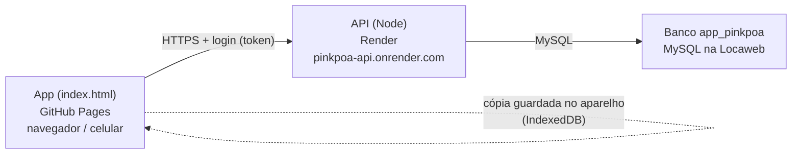

# Gestão Pink Poá — ERP

Sistema de gestão da **R.M. Fashion e Confecção** (marca Pink Poá): faturamento, comissões de
representantes, recebíveis, contas a pagar, conciliação bancária, vendas, estoques e compras.
Os dados vêm dos arquivos exportados do ERP Audience (CSV), de planilhas de e-commerce e do
extrato do Pagar.me.

- **Abrir o sistema:** https://pinkpoafinanceiro.com.br (o endereço antigo do GitHub Pages redireciona para ele)
- **Versão atual:** aparece no topo e no rodapé (`v2.14.NNN`).

---

## 1. Como o sistema é montado

São três partes, cada uma num lugar:

| Parte | Onde fica | O que faz |
|---|---|---|
| **App** (`index.html`, este repositório, **público**) | GitHub Pages | Todas as telas, cálculos, importação dos arquivos, relatórios em PDF/Excel. É um arquivo HTML único. |
| **API** (repositório **privado** `pinkpoa-api`) | Render (serviço web Node) | Login, usuários e permissões, guarda e entrega os dados, preenche as tabelas do MySQL. |
| **Banco** `app_pinkpoa` | MySQL na Locaweb | Usuários, cópias dos dados do app e as tabelas de consulta (clientes, faturamento, recebíveis…). |

> **Regra de segurança:** este repositório é público. Aqui fica **somente** o `index.html`
> (e este README). Nunca colocar aqui o `server.js`, senhas, tokens, backups `.json` ou o `CLAUDE.md`.
> O HTML não contém dados da empresa nem senhas — os dados chegam pelo login.

---

## 2. Como funciona no dia a dia

### Entrar
1. Abra o link do sistema e entre com **e-mail e senha** (usuário criado pelo administrador).
2. No **primeiro acesso de todos** (banco sem nenhum usuário), a própria tela de login pede para
   **criar o administrador**.
3. O login vale **7 dias** no aparelho. **Sair** (menu) encerra a sessão e apaga os dados do aparelho.

### Carregar os dados
- Ao abrir, o app mostra **na hora** a última cópia guardada no aparelho e, em segundo plano,
  pergunta ao servidor se existe uma cópia mais nova. Se houver, baixa (compactada) e atualiza a tela.
- Sem internet ou com o servidor fora do ar, o app abre com a cópia do aparelho.
- A bolinha no topo (**⬤ API**) mostra a situação do servidor; clicar nela abre o painel **☁ Servidor**.

### Atualizar os dados (quem tem permissão de editar)
1. **Importação** → selecione a pasta/arquivos exportados do Audience (CSV), planilhas e extratos.
2. Pronto: **o app salva sozinho no servidor** (salvamento automático). Toda mudança — importação, edição,
   exclusão, configuração — vai para o banco cerca de 15 segundos depois da última ação na tela, e também ao **Sair**.
   A bolinha **⬤ API** mostra "salvo hh:mm" ao passar o mouse.
3. Se outra pessoa salvou no servidor depois que você abriu o app, o automático **pausa e avisa** (para não apagar
   o trabalho dela): use **☁ Salvar no servidor** (substitui) ou **⬇ Carregar do servidor**.
- A cópia vai **compactada** (≈ 6× menor) e o servidor guarda as **30** últimas versões.

### Varredura da pasta: só entra o que é novo
- Cada arquivo importado deixa uma "impressão digital" do conteúdo. Na próxima varredura, um arquivo
  **idêntico** aparece como **"já importado em dd/mm"** e não entra de novo; o botão
  **⚡ Importar tudo** só importa os tipos que têm arquivo novo.
- **Faturamento, clientes, representantes, naturezas, produtos e preços** somam pela chave: entram todos
  os arquivos novos, do mais antigo ao mais novo — se a mesma nota/cadastro aparece em mais de um, vale o
  arquivo mais novo.
- **Recebíveis (vpdpcl1), banco (vpbanc3), pedidos/estoque, Contas a Pagar e cartão** são a foto da posição
  atual: vale o arquivo mais novo (os mais antigos aparecem como ignorados).
- O **Histórico de Importações** mostra, em cada importação, quantos registros foram **novos, alterados,
  sem mudança e removidos**.
- Para forçar, marque "Reimportar também os arquivos que já foram importados". **Zerar base** também
  esquece as impressões digitais.

### O que acontece no servidor ao salvar
- A cópia completa é guardada (o servidor mantém as **10 últimas** versões).
- Em seguida o servidor **preenche as tabelas do MySQL** (clientes, representantes, faturamento,
  comissões, recebíveis e cartão, duplicatas e movimentos bancários, naturezas, produtos, estoques, itens de
  venda, **contas a pagar, recebidos, extrato bancário, documentos e conciliação bancária, compras (NF-e) com
  itens e vencimentos, supervisões** e log de importação) para consulta direta no banco (Navicat etc.).
- **Duplicidade não entra no banco:** se uma chave se repete (ex.: o mesmo título/parcela duas
  vezes), nenhuma das ocorrências é gravada. A lista volta para o app em
  **☁ Servidor → Tabelas do MySQL → Ver duplicidades** (com botão **⬇ Baixar CSV**) para ser
  corrigida na origem e reimportada.

---

### Fluxo de Caixa Projetado (menu Financeiro → 💵 Fluxo de Caixa → 📈 Projetado)
- Plano mês a mês: **início** e **número de meses** configuráveis, **saldo inicial** em caixa e saldo final acumulado.
- **Faturamento bruto** previsto (padrão = média dos últimos meses fechados; digitável mês a mês) − **devolução %**
  (histórico; editável) = **faturamento líquido**.
- **Entradas** = contas a receber da **carteira real** (títulos em aberto pelo vencimento) + **vendas simuladas**
  (faturamento líquido previsto distribuído pelo prazo de recebimento medido na carteira) + linhas extras.
- **Saídas** = uma linha por grupo (ou subgrupo) do plano de contas, cada uma com a sua **regra**: *Auto* (o maior entre
  o já lançado no contas a pagar e a média realizada) · *só o lançado* · *média* · *fixo R$/mês* · *% do faturamento
  líquido*. Qualquer célula pode ser digitada por cima (fica amarela; vazio volta à regra). No mês corrente conta só o
  que falta sair. **＋ Linha** cria entradas/saídas extras (empréstimo, aporte, parcelamento…).
- **❄ Congelar previsto** guarda a foto; a aba **⚖ Previsto × Realizado** compara mês a mês (previsto, realizado, variação).
- Respeita as CIAs marcadas (RMF/RK). O plano fica salvo e vai ao servidor junto com o módulo Fluxo.

### Fluxo de Caixa Realizado (menu Financeiro → 💵 Fluxo de Caixa)
- **Todos os lançamentos da base**, sem os filtros da posição de fechamento: saídas = todos os títulos do
  ERP_PGTO com data de pagamento (valor pago); entradas = baixas de clientes do vpdpcl2 (sem elas, os títulos
  com baixa dos recebíveis).
- **Escolha das CIAs** que participam: a Pink Poá tem duas, **RMF** e **RK** — marque/desmarque no topo (fica salvo).
  Todos os recebimentos de clientes (todas as filiais e o e-commerce) são da RMF; a RK entra só com os pagamentos.
- **Agrupado por contas** pelo código do plano (CODPLA): grupo `11` › subgrupo `11.01` › conta `11.01.08`, com ▸/▾ para
  abrir e fechar e os botões "abrir até o nível 1-2-3-4"; coluna **%** do total. Os grupos sem nome na base podem ser
  nomeados no **✎** (fica salvo). Entradas: Recebimentos › tipo › CIA.
- **🔎 Análise do período** (automática): cobertura das saídas pelas entradas, médias, meses negativos, concentração nas
  5 maiores contas, para onde vai o dinheiro por grupo, contas fora do padrão no último mês **fechado** e pagamentos sem plano. O período padrão termina no último mês fechado
  (o mês corrente, parcial, fica fora das comparações).
- Resultado e acumulado mês a mês; lista de lançamentos com busca e **📊 Excel** (com grupo, subgrupo e código da conta).

## 3. Usuários e acessos

- Menu **👥 Usuários e Acessos** (só administrador): criar, alterar e desativar usuários e definir, **para cada
  módulo**, o que a pessoa pode fazer:
  - **Ver** — consultar e filtrar;
  - **Incluir** — registros novos e importações;
  - **Alterar** — mudar o que já existe;
  - **Excluir** — apagar/zerar;
  - **Relatórios** — PDF, Excel e exportações.
  Atalhos: "Nada", "Tudo: só consulta", "Tudo: completo" e ✓/✕ por módulo.
- **Convite por link:** ao criar o usuário **sem senha**, aparece o link de acesso com botões **Copiar**,
  **WhatsApp** e **E-mail**. A pessoa abre o link, vê o próprio nome, cria a senha e já entra com os acessos
  liberados. O link vale **48 horas** e só funciona uma vez. Para quem esqueceu a senha ou perdeu o link, use
  **🔗 Convite** na linha do usuário (o link anterior deixa de valer). A lista mostra "convite pendente".
- **🔎 Buscar no cadastro** (topo da tela do usuário): digite nome, código, e-mail ou CNPJ. Escolhendo um **representante**,
  o app preenche nome, e-mail e cargo, marca Faturamento/Comissões/Recebíveis/Clientes/Vendas em consulta + relatórios e
  libera só os dados dele. Escolhendo um **usuário**, copia os acessos dele (módulos e representantes). Tudo pode ser ajustado antes de salvar.
- **👁 Prévia** (na linha de cada usuário): gera um PDF com as telas de cada módulo liberado exatamente como essa pessoa
  vê — mesmos dados que o servidor entrega a ela (módulos, ações e representantes) — com uma capa resumindo os acessos.
  Serve para conferir antes de enviar o convite. Nada é gravado.
- **Meses que o usuário enxerga:** no cadastro, "Mês de fechamento" de/até (comissões, faturamento, vendas, recebidos, banco)
  e "Mês de vencimento" de/até (recebíveis, duplicatas, contas a pagar). Em branco = todos. O servidor entrega só esses
  meses e recusa gravar fora deles. A lista mostra "📅 …" e a pessoa vê no topo "Meses liberados: …".
- **Acesso por representante:** no cadastro do usuário, em "Representantes que este usuário enxerga", escolha **Todos** ou
  **Somente os marcados** (com busca). Ele passa a ver só o faturamento, as comissões, os recebíveis, as vendas e os
  clientes desses representantes — os totais da empresa não aparecem — e o servidor recusa gravar registros de outros
  representantes. A lista de usuários mostra "👤 N representante(s)".
- No app, os botões de cada ação que a pessoa não tem ficam travados e uma faixa mostra o que ela pode fazer
  naquele módulo. **No servidor**, cada registro é conferido ao salvar: o que ela não pode fazer é recusado
  (e o app avisa quantas mudanças foram recusadas).
- O servidor entrega a cada usuário **só os dados dos módulos liberados**. Clientes, representantes e naturezas
  vão para todos como cadastro de referência (nomes nas telas).
- Usuário desativado perde o acesso imediatamente. Sempre existe pelo menos um administrador ativo.
- **Senha: de 6 a 10 números, somente números** (os campos de senha só aceitam números e abrem o teclado numérico no celular).
  Cada usuário troca a própria senha em **🔑 Minha senha**.
- **5 senhas erradas seguidas travam o login por 15 minutos.** Para destravar antes, o administrador envia um novo link (🔗 Convite).

---

## 4. Configurações (administrador)

Menu **⚙️ Configurações**:
- **Servidor (Render):** tempo de resposta, há quanto tempo está acordado, MySQL, versão da API e memória.
- **Histórico de versões:** cada "☁ Salvar no servidor" vira uma versão (ficam as 10 últimas), com quem
  salvou, quando e o que mudou em cada lista (ex.: "Faturamento +120", "Clientes alterada"). O botão
  **↩ Voltar para esta versão** devolve os dados do servidor a uma versão anterior — a volta também vira
  uma versão, então dá para desfazer.
- **Plano do servidor:** no plano **grátis** o Render "dorme" após 15 min sem uso (a primeira chamada
  espera até ~50 s). A tela traz o passo a passo e o botão para mudar para o plano **pago (Starter)**
  no site do Render, ou a alternativa grátis com o **UptimeRobot** chamando `/health` a cada 5 min.

---

## 5. Celular

O app é responsivo: menu lateral que abre pelo ☰, topo compacto (bolinha da API, compartilhar,
usuário), quadros de números em duas colunas e tabelas com rolagem lateral dentro do próprio quadro.
Pode ser adicionado à tela inicial do celular pelo navegador ("Adicionar à tela de início").

---

## 6. Publicar uma nova versão do app

O app é só o `index.html`. Publicar = substituir o arquivo neste repositório (branch `main`);
o GitHub Pages atualiza o site em 1–3 minutos (abrir com **Ctrl+F5**).

1. Editar o `index.html` com mudanças pontuais (o sistema é um arquivo único; não reescrever a arquitetura).
2. Subir a versão no rodapé: o texto do `` (`>v2.14.NNN`). O topo copia dele.
3. Validar: extrair o maior `<script>` e rodar `node --check`.
4. Commit com a mensagem `v 2.14.NNN — resumo` e push para `main`.

Sem ferramentas de desenvolvimento: o arquivo **`PUBLICAR_PINKPOA_1.bat`** (no computador do
administrador) pega o `GESTAO_PINKPOA_v*.html` mais recente da pasta Downloads, copia como
`index.html` e envia ao GitHub.

---

## 7. Arquivos de origem (importação)

| Arquivo | Conteúdo |
|---|---|
| `vpfatu1` / `vpfatu2` | Faturamento (notas fiscais) |
| `vp42541a` / `vp42541b` | Comissões dos representantes |
| `vpdpcl1` / `vpdpcl2` | Títulos a receber e seus movimentos (baixas, trocas) |
| `vpbanc3`, `vpdocx1` | Movimentos bancários e documentos de cobrança |
| `vprepr1`, `vpclie1` | Cadastro de representantes e de clientes |
| `vp0000` (planilha) | E-commerce |
| Extrato Pagar.me (`.xlsx`) | Cartão a receber |
| NF-e de compra (XML/PDF/planilha) | Compras e contas a pagar |

CSV do Audience: separador `;`, codificação Windows-1252.

---

## 8. Documentação técnica

- **API, banco, instalação do servidor, rotas e tabelas:** `README.md` do repositório privado `pinkpoa-api`.
- **Histórico completo, regras de negócio e decisões:** `CLAUDE.md` (fica fora dos repositórios,
  na pasta `C:\PINKPOA` do administrador).
