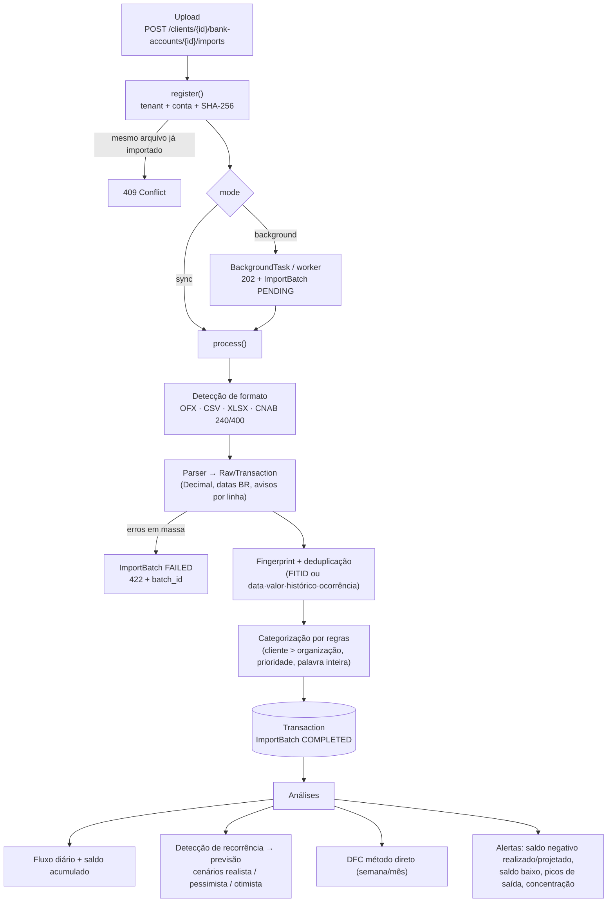

# Finance Engine — Ingestão e Análise Financeira (FastAPI)

Módulo de **ingestão, padronização e análise de dados financeiros** para um SaaS de consultoria
financeira multi-empresa (tenant = organização/consultoria) e multi-cliente (PF e PJ).

```bash
pip install -e ".[dev]"
uvicorn finance_engine.main:app --reload      # docs em http://localhost:8000/docs
pytest && mypy src && ruff check src tests     # 72 testes, mypy --strict
python -m finance_engine.worker               # fila de processamento (produção)
```

Configuração por ambiente (`FIN_DATABASE_URL=postgresql+psycopg://...`, `FIN_MAX_UPLOAD_BYTES`,
`FIN_LOW_BALANCE_THRESHOLD`, …) — ver `core/config.py`.

## Fluxo de processamento



## Estrutura

```
src/finance_engine/
  core/        config, exceções de domínio, validação CPF/CNPJ
  db/          Base declarativa (Numeric(18,2), UUID, naming convention), engine/sessões
  models/      Organization, Client, BankAccount, ImportBatch, Category, CostCenter,
               CategorizationRule, Transaction
  ingestion/   normalization (valores/datas BR), detection, registry,
               ofx.py, tabular.py (CSV/XLSX via pandas), cnab/ (layout posicional, 240, 400)
  analysis/    categorization.py, cashflow.py, forecast.py, statements.py  (funções puras)
  services/    ingestion_service, categorization_service, analytics_service, taxonomy
  api/         deps (sessão + tenant), errors, schemas, routers/
```

## Endpoints (`/api/v1`)

| Método | Rota | Descrição |
|---|---|---|
| POST | `/organizations` | cria tenant (já com plano de categorias e ~140 regras padrão) |
| POST/GET | `/clients` | clientes PF/PJ (CPF/CNPJ validado) |
| POST/GET | `/clients/{id}/bank-accounts` | contas bancárias |
| POST | `/clients/{id}/bank-accounts/{id}/imports` | upload OFX/CSV/XLSX/CNAB, `mode=sync\|background`, `column_mapping` (JSON) |
| GET | `/imports/{batch_id}` · `/clients/{id}/imports` | status/auditoria das importações |
| GET | `/clients/{id}/transactions` | lançamentos com filtros e paginação |
| PATCH | `/transactions/{id}/category` | categorização manual (nunca sobrescrita por regra) |
| GET/POST | `/categories` · `/categorization-rules` | plano de categorias e regras (ex.: `FORNECEDOR X → Custo de Mercadorias`) |
| POST | `/clients/{id}/recategorize` | reaplica regras |
| GET | `/clients/{id}/analytics/cash-flow` | fluxo diário, resumo, maiores despesas, recorrências, alertas |
| GET | `/clients/{id}/analytics/cash-flow-statement` | DFC por período (operacional/financeiro/transferências) |
| GET | `/lookup/cnpj/{cnpj}` | Cadastro da Receita: razão social, situação, CNAE, endereço, Simples/MEI, sócios (QSA), alertas e setor sugerido (BrasilAPI → CNPJ.ws → CNPJá) |
| GET | `/lookup/cep/{cep}` | Endereço pelo CEP (BrasilAPI → ViaCEP → OpenCEP) |
| GET | `/lookup/banks` · `/lookup/holidays/{ano}` | Bancos (código COMPE) e feriados nacionais |
| POST | `/clients/from-cnpj` | Cadastra o cliente só com o CNPJ, preenchendo tudo pela Receita |
| POST | `/auth/login` · GET `/auth/me` | login (token Bearer) com papel Master, Consultor ou Cliente |
| POST/GET | `/auth/users` | usuários da consultoria (só Master); usuário Cliente fica preso ao próprio `client_id` |
| POST | `/clients/{id}/titles/import` | contas a receber/pagar por planilha (reimportar atualiza saldos) |
| GET | `/clients/{id}/titles` · `/titles/aging` | títulos em aberto e aging list (faixas, inadimplência, concentração) |
| GET | `/clients/{id}/reconciliation/suggestions` | casamento extrato × títulos (1:1 e 1 lançamento : até 3 títulos), com pontuação e motivos |
| POST | `/clients/{id}/reconciliation/apply` | aplica as sugestões automáticas (corpo vazio) ou as escolhidas (Master/Consultor) |
| POST | `/tools/anticipation` · `/clients/{id}/anticipation` | simulação de antecipação: deságio, IOF, tarifas, CET a.m./a.a. e comparação com outra linha |
| POST/GET/PATCH | `/clients/{id}/statements` | balanço/DRE/balancete por SPED ECD, planilha ou PDF (texto ou IA); revisão e validação |
| GET | `/clients/{id}/analytics/indicators` | PMR, PMP, PME, ciclos, NCG, saldo de tesouraria, liquidez, margens, ponto de equilíbrio e alertas |

Acesso: em produção use `Authorization: Bearer <token>` de `/auth/login` e defina
`FIN_SECRET_KEY` (segredo forte) e `FIN_ALLOW_HEADER_TENANT=false`. O header `X-Organization-Id`
existe só para desenvolvimento.

A projeção de caixa (`/analytics/cash-flow` com horizonte futuro) soma os títulos em aberto: a
receber na data provável (vencimento + atraso médio do cliente), a pagar no vencimento; vencidos há
mais de 90 dias ficam fora como duvidosos.

### Inteligência artificial (Claude, ChatGPT ou Gemini)

A leitura de balanços/DREs em PDF usa a mesma interface para os três fornecedores
(`finance_engine.ai`). Instale `pip install -e ".[ai,pdf]"` e configure:

| Variável | Valor |
|---|---|
| `FIN_AI_PROVIDER` | `claude` (padrão), `openai`, `gemini` ou `none` |
| `FIN_AI_MODEL_CLAUDE` | padrão `claude-opus-5-5` |
| `FIN_AI_MODEL_OPENAI` / `FIN_AI_MODEL_GEMINI` | modelo da sua conta (obrigatório para esses fornecedores) |
| `ANTHROPIC_API_KEY` / `OPENAI_API_KEY` / `GEMINI_API_KEY` | chave do fornecedor escolhido (só no ambiente, nunca no código) |

A resposta da IA vem em JSON validado por esquema e entra como **rascunho**: o consultor revisa
e valida antes de os indicadores usarem os números.

### Fila de processamento

Importações em segundo plano vão para a tabela `jobs` (com retentativas). Em produção defina
`FIN_JOBS_INLINE=false` e rode um ou mais `python -m finance_engine.worker`; no PostgreSQL a
captura usa `FOR UPDATE SKIP LOCKED`. Arquivos ficam em `FIN_STORAGE_DIR`.

Exemplo de upload de planilha com mapeamento:

```bash
curl -X POST "$API/clients/$CLIENT/bank-accounts/$ACCOUNT/imports" \
  -H "X-Organization-Id: $ORG" \
  -F file=@extrato.xlsx -F mode=background -F sheet_name=Extrato \
  -F 'column_mapping={"date":"Dt. Movimento","description":["Histórico"],"amount":"Valor R$","dc_indicator":"D/C"}'
```

## Escolhas técnicas

- **Dinheiro sempre em `Decimal` / `Numeric(18,2)`**; valor com sinal (+ receita / − despesa) e
  `CHECK` garantindo coerência com o tipo — somas diretas em SQL, sem `CASE`.
- **Multi-tenancy por coluna** (`organization_id` em todas as tabelas, inclusive desnormalizado em
  `Transaction`, com índice composto). Recursos de outro tenant retornam **404** (não 403) para não
  vazar existência. Simples de evoluir para Row-Level Security no PostgreSQL.
- **Idempotência em dois níveis**: hash SHA-256 do arquivo por conta (reenvio = 409; lote que falhou
  pode ser reprocessado) e `fingerprint` único por lançamento, que absorve extratos com períodos
  sobrepostos. O índice de ocorrência no fingerprint preserva lançamentos legítimos idênticos
  (duas tarifas PIX iguais no mesmo dia).
- **Parsers puros (`bytes → ParseResult`)** atrás de uma interface única e um registry: fáceis de
  testar e de estender. Erros pontuais viram avisos com nº da linha; acima de 20% de linhas
  inválidas o arquivo é rejeitado (provável mapeamento errado).
- **OFX sem biblioteca externa**: tokenizador próprio cobre SGML 1.x e XML 2.x e as manias dos
  bancos brasileiros (CP1252, vírgula decimal, `[-3:BRT]`, débito positivo com `TRNTYPE=DEBIT`).
- **CSV/XLSX via pandas sem inferência de tipos** (`dtype=object`): detecção automática do
  cabeçalho (ignora preâmbulo), sinônimos de colunas em português, crédito/débito separados,
  coluna D/C, linhas de "SALDO" ignoradas, serial de data do Excel.
- **CNAB declarativo**: campos com as posições exatamente como nos manuais (1-based), perfis por
  banco no CNAB 400 (Bradesco, Itaú, Santander) e overrides no 240. Só liquidações geram
  lançamento (valor líquido creditado); remessa é rejeitada com mensagem clara. **Valide as
  posições com o manual do banco do cliente antes de produção.**
- **Categorização determinística e explicável**: cada lançamento guarda a regra que o categorizou;
  regras do cliente vencem as da organização; `CONTAINS` casa por palavra inteira e sem acento.
  Categorização manual nunca é sobrescrita.
- **Previsão por recorrência** (no estilo Agicap/Float/Granatum): aprende padrões semanais a
  anuais nos últimos 180 dias (assinatura do histórico sem números + cadência regular + valor
  estável), projeta até o fim do período, **suprime a previsão quando já existe o lançamento real**
  (±3 dias) e aplica cenários. A DFC informa a fração de cada período que é previsão.
- **Anomalias robustas**: picos de saída por mediana + k·MAD (não distorce com outliers), trechos
  contínuos de saldo negativo separados em realizado × projetado.
- **SQLAlchemy síncrono**: o gargalo é CPU (parsing/pandas), não I/O; endpoints `def` rodam no
  threadpool. O processamento depende só do `batch_id`, então trocar `BackgroundTasks` por
  Celery/ARQ + object storage é mudança de infraestrutura, não de domínio.

## Próximos passos sugeridos

Alembic para migrações · armazenamento em S3/GCS · sugestão de regras a partir das
categorizações manuais mais frequentes · títulos a partir de CNAB de cobrança e XML de NF-e.
